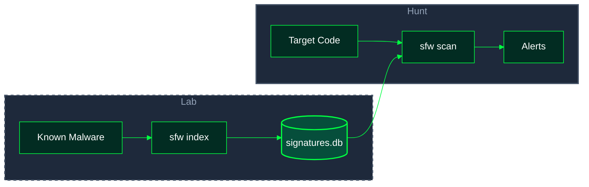
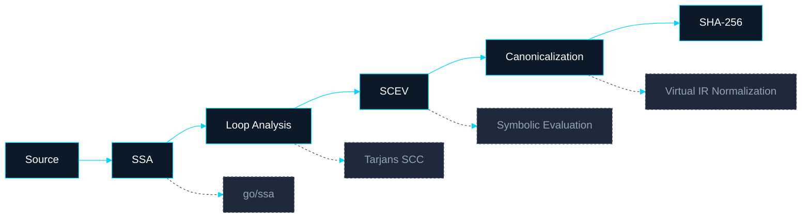

<div align="center">

# Semantic Firewall

### Next-Gen Code Integrity & Malware Detection for Go

[](https://pkg.go.dev/github.com/BlackVectorOps/semantic_firewall/v4)
[](LICENSE)
[](https://github.com/marketplace/actions/semantic-firewall)
[](https://github.com/BlackVectorOps/semantic_firewall/actions/workflows/semantic_analysis.yml)

**Catch the risky change a `git diff` hides.**

**Semantic Firewall** fingerprints Go by its *structure and behavior*, not its text -- so refactors and renames don't break your security gates, and a newly introduced capability (an `os/exec`, `net`, or raw `syscall` call that wasn't there before) stands out even when it's moved or obfuscated.

Deterministic, and honest about its edges: it tells you what it catches, where it hands off to a judgment layer, and what it does not score -- see [Detection scope](#detection-scope).

</div>

---

> [!CAUTION]
> **Disclaimer:** This tool is provided for **defensive security research and authorized testing only**. The malware scanning features are designed to help security teams detect and analyze malicious code patterns. Do not use this tool to create, distribute, or deploy malware. Users are responsible for ensuring compliance with all applicable laws and organizational policies. The author assumes no liability for misuse.

---


## What is Semantic Firewall?

**Semantic Firewall** is a new kind of static analysis tool for Go that:

- **Fingerprints code by behavior, not by text** -- so you can refactor, rename, or reformat without breaking your security gates.
- **Detects malware and backdoors** -- even if attackers try to hide them with obfuscation or clever tricks.
- **Flags risky changes in pull requests** -- so you know when something *really* changes, not just when someone moves code around.

**Why is this different?**

- Traditional tools (like `git diff`, grep, or hash-based scanners) are easily fooled by renaming, whitespace, or code shuffling.
- **Semantic Firewall** understands the *structure* and *intent* of your code. It knows when a function is logically the same--even if it looks different.
- It also knows when something *dangerous* is added, like a hidden network call or a suspicious loop.

**Key Features:**

- **Behavioral fingerprinting**: Prove your code hasn't changed in intent, even after big refactors.
- **Malware & backdoor detection**: Find threats by structure, not just by name or hash.
- **Risk-aware diffs**: Instantly see if a PR adds risky logic, not just lines changed.
- **Obfuscation & entropy analysis**: Spot packed or encrypted payloads.
- **Zero-config persistent database**: Fast, scalable PebbleDB backend.
- **gVisor Sandboxing**: Isolated execution for untrusted code analysis.

<details>
<summary><strong>See full feature table</strong></summary>

| Feature | Description |
|---------|-------------|
| **Loop Equivalence** | Proves loops are logically identical, no matter the syntax |
| **Semantic Diff** | Diffs code by behavior, not by text |
| **Malware Indexing** | Store and hunt for known malware patterns |
| **Obfuscation Detection** | Flags suspiciously complex or packed code |
| **Dependency Scanning** | Scans your code and all its dependencies |
| **gVisor Isolation** | Sandboxed execution via runsc for defense-in-depth |

</details>

---

## Detection scope

Semantic Firewall is a **deterministic** structural analyzer, and it is deliberate about its boundaries -- naming them is what makes a green result worth trusting.

**What it demonstrably catches.** Capability *introductions* that resolve to a concrete call target -- a function that newly reaches process execution, raw syscalls, plugins, the network, reflective invocation, or filesystem mutation (`os/exec`, `syscall`, `plugin`, `net`, `net/http`, `reflect.Value.Call`, `os.WriteFile`, ...). A newly reached capability escalates on its own, even when it *replaces* an existing call and the call count is unchanged; ordinary churn (new benign calls, loops, branches) stays below the high-risk threshold. See [Risk-Aware Diff Scoring](#architecture--algorithms). Structural fingerprinting makes this survive renames, moves, and reformatting.

**Where it hands off.** Calls reached through interface dispatch, function values, or reflection don't resolve to a concrete target -- they land in an `invoke:` / `dynamic:` bucket (roughly one in ten call sites across a 10-module corpus). These are **ceded, not flagged**: the deterministic core marks the seam where a separate judgment layer is needed, rather than guessing.

**What it does not score (known limitations).**

- **Deletion attacks are only partly covered.** Removing a call to a verification primitive -- `hmac.Equal`, `subtle.ConstantTimeCompare`, a signature or certificate `Verify*`, `bcrypt.CompareHashAndPassword`, `filepath.IsLocal` -- or deleting a function that made one, is a high-risk change (`RemovedCheck(...)`). A guard written as a plain conditional -- a bounds check, `if user != admin`, a TLS field assignment -- carries no call, and removing it is reported (`Branches-1`, changed literals in `added_ops`/`removed_ops`) but not scored. It will not flip the audit verdict on its own.
- **Parse coverage.** Files the loader can't build are skipped, not analyzed -- so "0 escalations" on a corpus means *zero among the analyzed commits*, not zero overall.
- **A clean false-positive rate is not a proven catch rate.** 0% FP on benign code shows the engine doesn't over-fire; catch rate is established separately, by the labeled positive controls above.

> The tool that tells you what it doesn't catch earns more trust than the one that implies it catches everything. The seams above (dynamic dispatch, deletion attacks) are exactly where a deeper, model-assisted judgment layer adds value -- and where we'd rather be honest about the gap than paper over it.

---

## Getting Started

```bash
go install github.com/BlackVectorOps/semantic_firewall/v4/cmd/sfw@latest
```


### Quick Start


```bash
# Check a file for risky changes
sfw check ./main.go

# See what *really* changed between two versions
sfw diff old_version.go new_version.go

# Index a known malware sample
sfw index malware.go --name "Beacon_v1" --severity CRITICAL

# Scan your codebase for malware (fast, O(1) matching)
sfw scan ./suspicious/

# Scan with dependency analysis
sfw scan ./cmd/myapp --deps

# See database stats
sfw stats
```

### Workflow: Lab → Hunt



<details>
<summary><strong>Show example outputs</strong></summary>

**Check Output:**
```json
{
  "file": "./main.go",
  "functions": [
    { "function": "main", "fingerprint": "005efb52a8c9d1e3...", "line": 12 }
  ]
}
```

**Diff Output (Risk-Aware):**
```json
{
  "summary": {
    "semantic_match_pct": 92.5,
    "preserved": 12,
    "modified": 1,
    "renamed_functions": 2,
    "high_risk_changes": 1
  },
  "functions": [
    {
      "function": "HandleLogin",
      "status": "modified",
      "added_ops": ["Call <log.Printf>", "Call <net.Dial>"],
      "risk_score": 32,
      "topology_delta": "Capability+network(net.Dial), Calls+1, AddedGoroutine"
    }
  ],
  "topology_matches": [
    {
      "old_function": "processData",
      "new_function": "handleInput",
      "similarity": 0.94,
      "matched_by_name": false
    }
  ]
}
```

**Scan Output (Malware Hunter):**
```json
{
  "target": "./suspicious/",
  "backend": "pebbledb",
  "total_functions_scanned": 47,
  "alerts": [
    {
      "signature_name": "Beacon_v1",
      "severity": "CRITICAL",
      "matched_function": "executePayload",
      "confidence": 0.92,
      "match_details": {
        "topology_match": true,
        "entropy_match": true,
        "topology_similarity": 1.0,
        "calls_matched": ["net.Dial", "os.Exec"]
      }
    }
  ],
  "summary": { "critical": 1, "high": 0, "total_alerts": 1 }
}
```

</details>

---


## Why Developers Need Semantic Firewall

- **No more noisy diffs:** See only what *matters*--real logic changes, not whitespace or renames.
- **Catch what tests miss:** Unit tests check correctness. Semantic Firewall checks *intent* and *integrity*.
- **Malware can't hide:** Renaming, obfuscation, or packing? Still detected.
- **Refactor with confidence:** Prove your big refactor didn't change what matters.
- **CI/CD ready:** Block PRs that sneak in risky logic.

| Traditional Tools | Semantic Firewall |
|-------------------|------------------|
| `git diff`        | `sfw diff`       |
| Sees lines changed | Sees logic changed |
| Fooled by renames | Survives refactors |
| Hash-based AV     | Behavioral fingerprints |
| YARA/grep         | Topology & intent matching |

**Use cases:**
- Supply chain security: catch backdoors that pass code review
- Safe refactoring: prove your refactor is safe
- CI/CD gates: block risky PRs
- Malware hunting: scan codebases at scale
- Obfuscation detection: flag packed/encrypted code
- Dependency auditing: scan imported packages

---


---

## Lie Detector Workflow

**Worried about sneaky changes or hidden intent?**

Supply chain attacks often hide behind boring commit messages like "fix typo" or "update formatting." `sfw audit` uses an LLM (Claude by default) to compare the **developer's claim** against the **code's reality**. The LLM is consulted only when the diff contains high-risk changes; a diff without them passes without an API call (and without an API key).

**Command:**

```bash
# Check if the commit message matches the code changes
export ANTHROPIC_API_KEY=...
sfw audit old.go new.go "minor refactor of logging"
```
**The Verdict:**

```json
{
  "inputs": {
    "commit_message": "minor refactor of logging"
  },
  "risk_filter": {
    "high_risk_detected": true,
    "evidence_count": 1
  },
  "output": {
    "verdict": "LIE",
    "evidence": "Commit claims 'minor refactor' but evidence shows addition of high-risk network calls (net.Dial) and goroutines."
  }
}
```

**How it works:**

1.  **Semantic Diff:** Calculates exact structural changes (ignoring whitespace).
2.  **Risk Filter:** Isolates high-risk deltas (Network, FS, Concurrency).
3.  **Intent Verification:** Asks the AI: *"Does 'fix typo' explain adding a reverse shell?"*

**Typical CI/CD workflow:**

```yaml
jobs:
  semantic-firewall:
    runs-on: ubuntu-latest
    steps:
      - uses: actions/checkout@v3
      - name: Run Semantic Firewall
        run: |
          go install github.com/BlackVectorOps/semantic_firewall/v4/cmd/sfw@latest
          sfw diff old.go new.go
          sfw scan . --deps
```

**Result:**
- PRs that only change formatting or names pass instantly.
- PRs that add risky logic or malware get flagged for review.

---

| Command | Purpose | Time Complexity | Space |
|---------|---------|-----------------|-------|
| `sfw check` | Generate semantic fingerprints | O(N) | O(N) |
| `sfw diff` | Semantic delta via Zipper algorithm | O(I) | O(I) |
| `sfw index` | Index malware samples into PebbleDB | O(N) | O(1) per sig |
| `sfw scan` | Hunt malware via topology matching | **O(1) exact** / O(M) fuzzy | O(M) |
| `sfw migrate` | Migrate JSON signatures to PebbleDB | O(S) | O(S) |
| `sfw stats` | Display database statistics | O(1) | O(1) |
| `sfw audit` | Verify commit intent (AI Lie Detector) | O(I) + API | O(I) |

Where N = source size, I = instructions, S = signatures, M = signatures in entropy range.

### Command Details

```bash
sfw check [--strict] [--scan --db <path>] [--no-sandbox] <file.go|directory>
```
Generate semantic fingerprints. Use `--strict` for validation mode. Use `--scan` to enable unified security scanning during fingerprinting. Use `--no-sandbox` to disable gVisor isolation.

```bash
sfw diff [--no-sandbox] <old.go> <new.go>
```
Compute semantic delta using the Zipper algorithm with topology-based function matching. Outputs risk scores and structural deltas.

```bash
sfw index <file.go> --name <name> --severity <CRITICAL|HIGH|MEDIUM|LOW> [--category <cat>] [--db <path>]
```
Index a reference malware sample. Generates topology hash, fuzzy hash, and entropy score.

```bash
sfw scan <file.go|directory> [--db <path>] [--threshold <0.0-1.0>] [--exact] [--deps] [--deps-depth <direct|transitive>] [--no-sandbox]
```
Scan target code for malware signatures. Use `--exact` for O(1) topology-only matching. Use `--deps` to scan imported dependencies. Use `--no-sandbox` to disable gVisor isolation.

```bash
sfw migrate --from <json> --to <db>
```
Migrate legacy JSON database to PebbleDB format for O(1) lookups.

```bash
sfw audit <old.go> <new.go> "<commit message>" [--model <model>] [--api-base <url>] [--no-sandbox]
```
Verify if a commit message matches the structural code changes. Uses an LLM to detect deception (e.g., hiding a backdoor in a "typo fix"). The default model is `claude-opus-5-5`; `gpt-*` and `gemini-*` models are also supported. The API key is read from `ANTHROPIC_API_KEY`, `OPENAI_API_KEY` or `GEMINI_API_KEY` according to the model (`--api-key` works but leaks into shell history); for Claude models the Anthropic SDK's credential chain (e.g. an `ant auth login` profile) also applies. A key is needed only when the diff has high-risk changes; if one is needed and missing, the audit fails closed with an `ERROR` verdict.

---

### gVisor Sandboxing

By default, `sfw check`, `sfw diff`, and `sfw scan` execute untrusted code analysis inside a **gVisor sandbox** (runsc) for defense-in-depth. This provides:

- **Syscall filtering**: Only whitelisted system calls are permitted
- **Memory isolation**: 512MB limit prevents resource exhaustion
- **Network isolation**: No outbound connections during analysis
- **Filesystem isolation**: Read-only access to target files only

**Requirements:**
- gVisor's `runsc` must be installed and available in `$PATH`
- On Linux, KVM acceleration is preferred (falls back to ptrace)

**Disabling the sandbox:**
```bash
# For development/debugging or environments without gVisor
sfw check ./main.go --no-sandbox
sfw scan ./suspicious/ --no-sandbox
```

> **Note:** The sandbox is automatically skipped if `runsc` is not available, with a warning message.

---

### Signature Database Configuration

The CLI automatically resolves the signature database location (`signatures.db`) in the following order:

1.  **Explicit Flag:** `--db /custom/path/signatures.db`
2.  **Environment Variable:** `SFW_DB_PATH`
3.  **Local Directory:** `./signatures.db`
4.  **User Home:** `~/.sfw/signatures.db`
5.  **System Strings:** `/usr/local/share/sfw/signatures.db` or `/var/lib/sfw/signatures.db`

This allows you to manage updates independently of the binary.

```bash
sfw stats --db <path>
```
Display database statistics including signature count and index sizes.

---


<details>
<summary><strong>Deep Technical Dive (Math, Graphs & Algorithms)</strong></summary>

<!-- All the advanced math, graphs, and technical details are moved here for power users -->

## Persistent Signature Database (PebbleDB)

The scanner uses **PebbleDB**, CockroachDB's embedded LSM-tree key-value store, for signature storage. This enables:

- **O(1) exact topology lookups** via indexed hash keys
- **O(M) fuzzy matching** via range scans on entropy indexes
- **Atomic writes**: no partial updates on crash
- **Concurrent reads**: safe for parallel scanning
- **Zero configuration**: single directory, no server required
- **Gob+PackedIdx encoding**: Efficient binary serialization

### Database Schema

Pebble uses a flat key-space, and we simulate buckets by using prefixes:

- `sig:ID -> JSON blob` (full signature)
- `topo:TopologyHash:ID -> ID` (O(1) exact match)
- `fuzzy:FuzzyHash:ID -> ID` (LSH bucket index)
- `entr:EntropyKey -> ID` (range scan index)
- `meta:key -> value` (version, stats, maintenance info)

### Entropy Key Encoding

Entropy scores are stored as fixed-width keys for proper lexicographic ordering:
```
Key: "005.1234:SFW-MAL-001"
      ├──────┤ ├─────────┤
      entropy  unique ID
```

This enables efficient range scans: find all signatures with entropy 5.0 ± 0.5.

### Database Operations

```bash
# View statistics
sfw stats --db signatures.db
{
  "signature_count": 142,
  "topology_index_count": 142,
  "entropy_index_size": 28672,
  "file_size_human": "2.1 MB"
}

# Migrate from legacy JSON (one-time operation)
sfw migrate --from old_signatures.json --to signatures.db

# Export for backup/compatibility
# (Programmatic API: scanner.ExportToJSON("backup.json"))
```

### Programmatic Database Access

```go
// Open database with options
opts := pebbledb.PebbleScannerOptions{
    MatchThreshold:   0.75,    // Minimum confidence for alerts
    EntropyTolerance: 0.5,     // Fuzzy entropy window
    ReadOnly:         false,   // Set true for scan-only mode
    CacheSize:        8 << 20, // 8MB cache
}
scanner, err := pebbledb.NewPebbleScanner("signatures.db", opts)
defer scanner.Close()

// Add signatures (single or bulk)
scanner.AddSignature(sig)
scanner.AddSignatures(sigs)  // Atomic batch insert

// Lookup operations
sig, _ := scanner.GetSignature("SFW-MAL-001")
sig, _ := scanner.GetSignatureByTopology(topoHash)
ids, _ := scanner.ListSignatureIDs()
count, _ := scanner.CountSignatures()

// Maintenance
scanner.DeleteSignature("SFW-MAL-001")
scanner.MarkFalsePositive("SFW-MAL-001", "benign library")
scanner.RebuildIndexes()  // Recover from corruption
scanner.Compact()          // full-range compaction in place
```

---

## Malware Scanning: Two-Phase Detection

The Semantic Firewall includes a **behavioral malware scanner** that matches code by its structural topology, not just strings or hashes. The scanner uses a two-phase detection algorithm:

### Phase 1: O(1) Exact Topology Match

```
1. Extract FunctionTopology from target SSA function
2. Compute topology hash: SHA-256(blockCount || callProfile || controlFlowFlags)
3. PebbleDB lookup: topo:TopologyHash:ID → signature IDs
4. Return exact matches with 100% topology confidence
```

### Phase 2: O(1) Fuzzy Bucket Match (LSH-lite)

```
1. Compute fuzzy hash: GenerateFuzzyHash(topology) → "B3L1BR3P1R1"
2. PebbleDB prefix scan: fuzzy:FuzzyHash:* → candidate IDs
3. Verify call signature overlap and entropy distance
4. Return matches above confidence threshold
```

**Why this survives evasion:**

- **Renaming evasion fails**: `backdoor()` → `helper()` still matches (names aren't part of topology)
- **Obfuscation-resistant**: Variable renaming and code shuffling don't change block/call structure
- **O(1) at scale**: PebbleDB indexes enable instant lookups even with thousands of signatures

### Fuzzy Hash Buckets (LSH-lite)

The fuzzy hash creates locality-sensitive buckets based on quantized structural metrics:

```
FuzzyHash = "B{log2(blocks)}L{min(loops,5)}BR{branches == 0 ? 0 : log2(branches)+1}P{params}R{results}"

Examples:
  B3L1BR3P1R1 = 8-15 blocks, 1 loop, 4-7 branches, 1 parameter, 1 result
  B4L2BR4P2R0 = 16-31 blocks, 2 loops, 8-15 branches, 2 parameters, no results
```

Log2 buckets reduce sensitivity to small changes while preserving structural similarity.

### Dependency Scanning

Scan not just your code, but all imported dependencies:

```bash
# Scan local code + direct imports
sfw scan ./cmd/myapp --deps --db signatures.db

# Deep scan: include transitive dependencies
sfw scan . --deps --deps-depth transitive --db signatures.db

# Fast exact-match mode for large codebases
sfw scan . --deps --exact --db signatures.db
```

**Output with dependencies:**
```json
{
  "target": "./cmd/myapp",
  "total_functions_scanned": 1247,
  "dependencies_scanned": 892,
  "scanned_dependencies": [
    "github.com/example/suspicious-lib",
    "github.com/another/dependency"
  ],
  "alerts": [...],
  "summary": { "critical": 0, "high": 1, "total_alerts": 1 }
}
```

| Flag | Description |
|------|-------------|
| `--deps` | Enable dependency scanning |
| `--deps-depth direct` | Scan third-party packages imported by any package of your module (default) |
| `--deps-depth transitive` | Also scan the dependencies of those packages |
| `--exact` | O(1) exact topology match only (fastest) |

> **Note:** Dependency scanning requires modules to be downloaded (`go mod download`). Stdlib packages are automatically excluded.

### Step 1: Index Known Malware (Lab Phase)

```bash
# Index a beacon/backdoor sample
sfw index samples/dirty/dirty_beacon.go \
    --name "DirtyBeacon" \
    --severity CRITICAL \
    --category malware \
    --db signatures.db

# Output:
{
  "message": "Indexed 1 functions from samples/dirty/dirty_beacon.go",
  "indexed": [{
    "name": "DirtyBeacon_Run",
    "topology_hash": "topo:9a8b7c6d5e4f3a2b...",
    "fuzzy_hash": "B3L1BR3P1R1",
    "entropy_score": 5.82,
    "identifying_features": {
      "required_calls": ["net.Dial", "os.Exec", "time.Sleep"],
      "control_flow": { "has_infinite_loop": true, "has_reconnect_logic": true }
    }
  }],
  "backend": "pebbledb",
  "total_signatures": 1
}
```

### Step 2: Scan Suspicious Code (Hunter Phase)

```bash
# Scan an entire directory
sfw scan ./untrusted_vendor/ --db signatures.db --threshold 0.75

# Fast mode: exact topology match only (O(1) per function)
sfw scan ./large_codebase/ --db signatures.db --exact
```

---

## Shannon Entropy Analysis

The scanner calculates **Shannon entropy** for each function to detect obfuscation and packed code:

$$H = -\sum_{i} p(x_i) \log_2 p(x_i)$$

Where $p(x_i)$ is the probability of byte value $x_i$ appearing in the function's string literals.

**Entropy Spectrum:**

```
     LOW          NORMAL              HIGH         PACKED
  ◀─────────────────────────────────────────────────────────▶
  │    ░░░░░░░░░░░░░░░░░░░░░░░░░░░░░░░░░▓▓▓▓▓▓▓▓▓▓▓████████│
  0                  4.0              6.5        7.5        8.0
  │                   │                │          │          │
  │  Simple funcs     │  Normal code   │ Obfusc.  │ Encrypted│
  │  (getters/setters)│  (business     │ (base64  │ (packed  │
  │                   │   logic)       │  strings)│  payloads)│
```

| Entropy Range | Classification | Meaning | Example |
|--------------|----------------|---------|---------|
| < 4.0 | LOW | Simple/sparse code | `func Get() int { return x }` |
| 4.0 - 6.5 | NORMAL | Typical compiled code | Business logic, handlers |
| 6.5 - 7.5 | HIGH | Potentially obfuscated | Base64 blobs, encoded strings |
| > 7.5 | PACKED | Likely packed/encrypted | Encrypted payloads, shellcode |

Functions with HIGH or PACKED entropy combined with suspicious call patterns receive elevated confidence scores.

### Multi-Signal Obfuscation Profile

Beyond string-literal entropy, each function gets an `ObfuscationProfile` combining six signals into a single 0..1 score (`NONE`/`LOW`/`MODERATE`/`HIGH`). The signals are weighted by evidentiary strength:

- **Dispositive** (data-entropy — sufficient alone to flag a function): sliding-window entropy over the full constant pool (catches a packed blob averaged away by benign log strings), non-string const-pool entropy (catches `[]byte{...}` / `[]int` payloads that never enter string literals), and byte-array payload runs.
- **Corroborating** (structural — consistent with idiomatic Go, so meaningful only in combination): indirect/reflective dispatch ratio, control-flow-flattening (fan-in concentration at a dispatcher header), and in-loop byte-decoder shape.

A single corroborating signal cannot by itself reach `MODERATE` — it takes one dispositive signal, or two corroborating signals together. This avoids flagging benign higher-order functions (callback runners, visitors, middleware), which are indirect-dispatch by construction.

**Known gap — package-level payloads.** Payload entropy is attributed per-function: a high-entropy literal local to the analyzed function is detected directly. Package-level payload globals are **not yet** attributed to their consuming function (the constants are lowered into package `init`, not the function body); these are intended to be caught by a paired decoder-loop heuristic, which is not yet implemented. Until then, package-level-blob + separate-decoder layouts are a known gap.

### Call Signature Resolution

The topology extractor resolves call targets to stable identifiers:

| Call Type | Resolution | Example |
|-----------|------------|---------|
| Static function | `pkg.Func` | `net.Dial` |
| Interface invoke | `invoke:Type.Method` | `invoke:io.Reader.Read` |
| Builtin | `builtin:name` | `builtin:len` |
| Closure | `closure:signature` | `closure:func(int) error` |
| Go statement | `go:target` | `go:handler.serve` |
| Defer statement | `defer:target` | `defer:conn.Close` |
| Reflection | `reflect:Call` | Dynamic dispatch |
| Dynamic | `dynamic:type` | Unknown target |

This stable resolution ensures signatures match even when:
- Code is moved between packages
- Interface implementations change
- Method receivers are renamed

---

## Topology Matching

The diff command now uses **structural topology matching** to detect renamed or obfuscated functions.

**How Topology Matching Works:**

```
┌─────────────────────────────────────────────────────────────────────────────┐
│                        TOPOLOGY FINGERPRINT EXTRACTION                       │
├─────────────────────────────────────────────────────────────────────────────┤
│                                                                             │
│   func processData(input []byte) error {        ──►  TOPOLOGY VECTOR        │
│       conn, _ := net.Dial("tcp", addr)                                      │
│       for _, b := range input {                      ┌──────────────────┐   │
│           conn.Write([]byte{b})                      │ Params: 1        │   │
│       }                                              │ Returns: 1       │   │
│       return conn.Close()                            │ Blocks: 4        │   │
│   }                                                  │ Loops: 1         │   │
│                                                      │ Calls:           │   │
│                                                      │   net.Dial: 1    │   │
│   func handleInput(data []byte) error {              │   Write: 1       │   │
│       c, _ := net.Dial("tcp", server)                │   Close: 1       │   │
│       for i := 0; i < len(data); i++ {               │ Entropy: 5.2     │   │
│           c.Write([]byte{data[i]})                   └──────────────────┘   │
│       }                                                      │              │
│       return c.Close()                                       ▼              │
│   }                                              ┌──────────────────────┐   │
│                                                  │  SIMILARITY: 94%     │   │
│   Different names, SAME topology  ───────────────│  ✓ MATCH DETECTED    │   │
│                                                  └──────────────────────┘   │
└─────────────────────────────────────────────────────────────────────────────┘
```

**Topology vs Name-Based Matching:**

```mermaid
flowchart LR
    subgraph old[Old Version]
        O1[processData]
        O2[sendPacket]
        O3[initConn]
    end
    
    subgraph new[New Version]
        N1[handleInput]
        N2[xmit]
        N3[setup]
    end
    
    O1 --> N1
    O2 --> N2
    O3 --> N3
    
    linkStyle 0 stroke:#10b981,stroke-width:3px
    linkStyle 1 stroke:#10b981,stroke-width:3px
    linkStyle 2 stroke:#10b981,stroke-width:3px
    
    style old fill:#1e1b4b,stroke:#8b5cf6,stroke-width:2px
    style new fill:#064e3b,stroke:#10b981,stroke-width:2px
```



> **Legend:** Green lines = topology match (94%+ similarity). Function names changed but structural fingerprints match.

```bash
sfw diff old_version.go refactored_version.go
```

```json
{
  "summary": {
    "preserved": 8,
    "modified": 2,
    "renamed_functions": 3,
    "topology_matched_pct": 85.7
  },
  "topology_matches": [
    {
      "old_function": "processData",
      "new_function": "handleInput",
      "similarity": 0.94,
      "matched_by_name": false
    }
  ]
}
```

Functions are matched by their **structural fingerprint** (block count, call profile, control flow features) rather than just name, enabling detection of:

- Renamed functions
- Copy-pasted code with modified names
- Obfuscated variants of known patterns

---

## Library Usage

The library packages live under `pkg/`; `pkg/api` is the entry point the CLI itself uses.

### Semantic Diff

```go
import "github.com/BlackVectorOps/semantic_firewall/v4/pkg/api"

out, err := api.Diff("old/handler.go", "new/handler.go")
if err != nil {
    log.Fatal(err)
}
for _, f := range out.Functions {
    fmt.Printf("%-30s %-9s risk=%d %s\n", f.Function, f.Status, f.RiskScore, f.TopologyDelta)
}
```

### Fingerprinting

```go
import (
    "github.com/BlackVectorOps/semantic_firewall/v4/pkg/analysis/ir"
    "github.com/BlackVectorOps/semantic_firewall/v4/pkg/diff"
)

src := `package main
func Add(a, b int) int { return a + b }
`

results, err := diff.FingerprintSource("example.go", src, ir.DefaultLiteralPolicy)
if err != nil {
    log.Fatal(err)
}

for _, r := range results {
    fmt.Printf("%s: %s\n", r.FunctionName, r.Fingerprint)
}
```

### Malware Scanning with PebbleDB

```go
import (
    "github.com/BlackVectorOps/semantic_firewall/v4/pkg/analysis/topology"
    "github.com/BlackVectorOps/semantic_firewall/v4/pkg/storage/pebbledb"
)

// Open the signature database
scanner, err := pebbledb.NewPebbleScanner("signatures.db", pebbledb.DefaultPebbleScannerOptions())
if err != nil {
    log.Fatal(err)
}
defer scanner.Close()

// Extract topology from an SSA function (r.GetSSAFunction() from a fingerprint result)
topo := topology.ExtractTopology(ssaFunction)

// O(1) exact topology match
if alert, err := scanner.ScanTopologyExact(topo, "suspiciousFunc"); err == nil && alert != nil {
    fmt.Printf("ALERT: %s matched %s (confidence: %.2f)\n",
        alert.MatchedFunction, alert.SignatureName, alert.Confidence)
}

// Full scan: exact + fuzzy entropy matching
alerts, err := scanner.ScanTopology(topo, "suspiciousFunc")
if err != nil {
    log.Fatal(err)
}
for _, alert := range alerts {
    fmt.Printf("[%s] %s: %s\n", alert.Severity, alert.SignatureName, alert.MatchedFunction)
}
```

### Topology Extraction

```go
import "github.com/BlackVectorOps/semantic_firewall/v4/pkg/analysis/topology"

// Extract structural features from an SSA function
topo := topology.ExtractTopology(ssaFunction)

fmt.Printf("Blocks: %d, Loops: %d, Entropy: %.2f\n",
    topo.BlockCount, topo.LoopCount, topo.EntropyScore)
fmt.Printf("Calls: %v\n", topo.CallTargets)          // import-path qualified
fmt.Printf("Capabilities: %v\n", topo.Capabilities)  // e.g. "os/exec.Command": "exec"
fmt.Printf("Entropy Class: %s\n", topo.EntropyProfile.Classification)
fmt.Printf("Fuzzy Hash: %s\n", topo.FuzzyHash)
```

### Unified Pipeline: Check + Scan

Enable security scanning during fingerprinting for a unified integrity + security workflow:

```go
// CLI: sfw check --scan --db signatures.db ./main.go

// Programmatically:
results, _ := diff.FingerprintSourceAdvanced(path, src, ir.DefaultLiteralPolicy, strictMode)

for _, r := range results {
    // Integrity: Get fingerprint
    fmt.Printf("Function %s: %s\n", r.FunctionName, r.Fingerprint)

    // Security: Scan for malware
    topo := topology.ExtractTopology(r.GetSSAFunction())
    alerts, _ := scanner.ScanTopology(topo, r.FunctionName)
    for _, alert := range alerts {
        fmt.Printf("ALERT: %s\n", alert.SignatureName)
    }
}
```

### Signature Structure

```go
type Signature struct {
    ID                  string              // "SFW-MAL-001"
    Name                string              // "Beacon_v1_Run"
    Description         string              // Human-readable description
    Severity            string              // "CRITICAL", "HIGH", "MEDIUM", "LOW"
    Category            string              // "malware", "backdoor", "dropper"
    TopologyHash        string              // SHA-256 of topology vector
    FuzzyHash           string              // LSH bucket key "B3L1BR3P1R1"
    EntropyScore        float64             // 0.0-8.0
    EntropyTolerance    float64             // Fuzzy match window (default: 0.5)
    NodeCount           int                 // Basic block count
    LoopDepth           int                 // Maximum nesting depth
    IdentifyingFeatures IdentifyingFeatures // Behavioral markers
    Metadata            SignatureMetadata   // Provenance info
}

type IdentifyingFeatures struct {
    RequiredCalls  []string          // Must be present (VETO if missing)
    OptionalCalls  []string          // Bonus if present
    StringPatterns []string          // Suspicious strings
    ControlFlow    *ControlFlowHints // Structural patterns
}

type ControlFlowHints struct {
    HasInfiniteLoop   bool  // Beacon/C2 indicator
    HasReconnectLogic bool  // Persistence indicator
}
```

---

## Architecture & Algorithms


### Pipeline Overview



1. **SSA Construction:** `golang.org/x/tools/go/ssa` converts source to Static Single Assignment form with explicit control flow graphs
2. **Loop Detection:** Natural loop identification via backedge detection (edge B->H where H dominates B)
3. **SCEV Analysis:** Algebraic characterization of loop variables as closed-form recurrences
4. **Canonicalization:** Deterministic IR transformation: register renaming, branch normalization, loop virtualization
5. **Fingerprint:** SHA-256 of canonical IR string

### Scalar Evolution (SCEV) Engine

The SCEV framework (`pkg/analysis/loop/scev.go`) solves the "loop equivalence problem" -- proving that syntactically different loops compute the same sequence of values.

**Core Abstraction: Add Recurrences**

An induction variable is represented as $\{Start, +, Step\}_L$, meaning at iteration $k$ the value is:

$$Val(k) = Start + (Step \times k)$$

This representation is closed under affine transformations:

| Operation | Result |
|-----------|--------|
| $\{S, +, T\} + C$ | $\{S+C, +, T\}$ |
| $C \times \{S, +, T\}$ | $\{C \times S, +, C \times T\}$ |
| $\{S_1, +, T_1\} + \{S_2, +, T_2\}$ | $\{S_1+S_2, +, T_1+T_2\}$ |

**IV Detection Algorithm (Tarjan's SCC)**

```
1. Build dependency graph restricted to loop body
2. Find SCCs via Tarjan's algorithm (O(V+E))
3. For each SCC containing a header Phi:
   a. Extract cycle: Phi -> BinOp -> Phi
   b. Classify: Basic ({S,+,C}), Geometric ({S,*,C}), Polynomial
   c. Verify step is loop invariant
4. Propagate SCEV to derived expressions via recursive folding
```

**Trip Count Derivation**

For a loop `for i := Start; i < Limit; i += Step`:

$$TripCount = \left\lceil \frac{Limit - Start}{Step} \right\rceil$$

Computed via ceiling division: `(Limit - Start + Step - 1) / Step`

The engine handles:
- Upcounting (`i < N`) and downcounting (`i > N`) loops
- Inclusive bounds (`i <= N` -- add 1 to numerator)
- Negative steps (normalized to absolute value)
- Multi-predecessor loop headers (validates consistent start values)

### Canonicalization Engine

The canonicalizer (`pkg/analysis/ir/canonicalizer.go`) transforms SSA into a deterministic string representation via five phases:

**Phase 1: Loop & SCEV Analysis**
```go
c.loopInfo = DetectLoops(fn)
AnalyzeSCEV(c.loopInfo)
```

**Phase 2: Semantic Normalization**
- **Invariant Hoisting**: Pure calls like `len(s)` are virtually moved to preheader
- **IV Virtualization**: Phi nodes for IVs are replaced with SCEV notation `{0, +, 1}`
- **Derived IV Propagation**: Expressions like `i*4` become `{0, +, 4}` in output

**Phase 3: Register Renaming**
```
Parameters: p0, p1, p2, ...
Free Variables: fv0, fv1, ...
Instructions: v0, v1, v2, ... (DFS order)
```

**Phase 4: Deterministic Block Ordering**

Blocks are traversed in dominance-respecting DFS order, ensuring identical output regardless of SSA construction order. Successor ordering is normalized:
- `>=` branches are rewritten to `<` with swapped successors
- `>` branches are rewritten to `<=` with swapped successors

**Phase 5: Virtual Control Flow**

Branch normalization is applied *virtually* (no SSA mutation) via lookup tables:
```go
virtualBlocks map[*ssa.BasicBlock]*virtualBlock  // swapped successors
virtualBinOps map[*ssa.BinOp]token.Token         // normalized operators
```

### The Semantic Zipper

The Zipper (`pkg/diff/zipper.go`) computes a semantic diff between two functions -- what actually changed in behavior, ignoring cosmetic differences.

**Algorithm: Parallel Graph Traversal**

```
PHASE 0: Semantic Analysis
  - Run SCEV on both functions independently
  - Build canonicalizers for operand comparison

PHASE 1: Anchor Alignment
  - Map parameters positionally: oldFn.Params[i] <-> newFn.Params[i]
  - Map free variables if counts match
  - Seed entry block via sequential matching (critical for main())

PHASE 2: Forward Propagation (BFS on Use-Def chains)
  while queue not empty:
    (vOld, vNew) = dequeue()
    for each user uOld of vOld:
      candidates = users of vNew with matching structural fingerprint
      for uNew in candidates:
        if areEquivalent(uOld, uNew):
          map(uOld, uNew)
          enqueue((uOld, uNew))
          break

PHASE 2.5: Terminator Scavenging
  - Explicitly match Return/Panic instructions via operand equivalence
  - Handles cases where terminators aren't reached via normal propagation

PHASE 3: Divergence Isolation
  - Added = newFn instructions not in reverse map
  - Removed = oldFn instructions not in forward map
```

**Equivalence Checking**

Two instructions are equivalent iff:
1. Same Go type (`reflect.TypeOf`)
2. Same SSA value type (`types.Identical`)
3. Same operation specific properties (BinOp.Op, Field index, Alloc.Heap, etc.)
4. All operands equivalent (recursive, with commutativity handling for ADD/MUL/AND/OR/XOR)

**Structural Fingerprinting (DoS Prevention)**

To prevent $O(N \times M)$ comparisons on high fanout values, users are bucketed by structural fingerprint:
```go
fp := fmt.Sprintf("%T:%s", instr, op)  // e.g., "*ssa.BinOp:+"
candidates := newByOp[fp]              // Only compare compatible types
```

Bucket size is capped at 100 to bound worst case complexity.

### Security Hardening

| Threat | Mitigation |
|--------|------------|
| **Untrusted code execution** | gVisor sandbox (`runsc`) isolates analysis |
| **Algorithmic DoS** (exponential SCEV) | Memoization cache per loop: `loop.SCEVCache` |
| **Quadratic Zipper** (5000 identical ADDs) | Fingerprint bucketing + `MaxCandidates=100` |
| **RCE via CGO** | `CGO_ENABLED=0` during `packages.Load` |
| **SSRF via module fetch** | `GOPROXY=off` prevents network calls |
| **Stack overflow** (cyclic graphs) | Visited sets in all recursive traversals |
| **NaN comparison instability** | Branch normalization restricted to `IsInteger \| IsString` types |
| **IR injection** (fake instructions in strings) | Struct tags and literals sanitized before hashing |
| **TypeParam edge cases** | Generic types excluded from branch swap (may hide floats) |
| **DB path traversal** | Databases are never created or written under system directories (`/etc`, `/usr` except `/usr/local`, `/bin`, `/lib*`, ...); read-only opens are allowed |
| **Resource exhaustion** | 512MB memory limit, 64 PIDs max in sandbox |

### Complexity Analysis

| Operation | Time | Space |
|-----------|------|-------|
| SSA Construction | $O(N)$ | $O(N)$ |
| Loop Detection | $O(V+E)$ | $O(V)$ |
| SCEV Analysis | $O(L \times I)$ amortized | $O(I)$ per loop |
| Canonicalization | $O(I \times \log B)$ | $O(I + B)$ |
| Zipper | $O(I^2)$ worst, $O(I)$ typical | $O(I)$ |
| **Topology Extract** | $O(I)$ | $O(C)$ |
| **Scan (PebbleDB exact)** | **$O(1)$** | $O(1)$ |
| **Scan (fuzzy entropy)** | $O(M)$ | $O(M)$ |

Where $N$ = source size, $V$ = blocks, $E$ = edges, $L$ = loops, $I$ = instructions, $B$ = blocks, $C$ = unique calls, $M$ = signatures in entropy range.

### Malware Scanner Architecture

The scanner (`pkg/storage/pebbledb/store.go`) provides two-phase detection with ACID-compliant persistence:

**Phase 1: O(1) Exact Topology Match**

```
1. Extract FunctionTopology from target SSA function
2. Compute topology hash: SHA-256(blockCount || callProfile || controlFlowFlags)
3. PebbleDB lookup: topo:TopologyHash:ID → signature ID
4. Return exact matches with 100% topology confidence
```

**Phase 2: O(1) Fuzzy Bucket Match (LSH-lite)**

```
1. Compute fuzzy hash: GenerateFuzzyHash(topo) → "B3L1BR3P1R1"
2. PebbleDB prefix scan: fuzzy:FuzzyHash:* → candidate IDs
3. For each candidate:
   a. Load signature from sig: prefix
   b. Verify call signature overlap
   c. Check entropy distance within tolerance
   d. Compute composite confidence score
4. Return matches above threshold
```

**PebbleDB Storage Schema**

PebbleDB uses a flat key-space with prefixes to simulate logical buckets:

```
sig:ID         → Gob-encoded signature blob (full signature)
topo:Hash:ID   → PackedIndexValue (O(1) exact match index)
fuzzy:Hash:ID  → PackedIndexValue (LSH bucket index)
entr:Key       → ID (range scan index, "005.1234:SFW-MAL-001")
meta:key       → value (version, stats, maintenance info)
```

**Entropy Key Encoding**

Entropy is stored as a fixed-width key for proper lexicographic ordering:
```go
key := fmt.Sprintf("%08.4f:%s", entropy, id)  // "005.8200:SFW-MAL-001"
```

This enables efficient range scans and ensures uniqueness even for identical entropy values.

**False Positive Feedback Loop**

The scanner supports learning from mistakes:
```go
// Mark a signature as generating false positives
scanner.MarkFalsePositive("SFW-MAL-001", "benign crypto library")

// This appends a timestamped note to the signature's metadata:
// "FP:2026-01-12T15:04:05Z:benign crypto library"
```

**Confidence Score Calculation**

The final confidence score is computed as a weighted average:

```go
confidence = avg(
    topologySimilarity,      // 1.0 if exact hash match
    entropyScore,            // 1.0 - (distance / tolerance)
    callMatchScore,          // len(matched) / len(required)
    stringPatternScore,      // bonus for matched patterns
)

// VETO: If ANY required call is missing, confidence = 0.0
```

### Topology Matching Algorithm

The topology matcher (`pkg/analysis/topology/topology.go`) enables function matching independent of names:

**Feature Vector**

```go
type FunctionTopology struct {
    FuzzyHash      string              // LSH bucket key
    ParamCount     int                 // Signature: param count
    ReturnCount    int                 // Signature: return count
    BlockCount     int                 // CFG complexity
    InstrCount     int                 // Code size
    LoopCount      int                 // Iteration patterns
    BranchCount    int                 // Decision points
    PhiCount       int                 // SSA merge points
    CallSignatures map[string]int      // "net.Dial" → 2
    BinOpCounts    map[string]int      // "+" → 5
    HasDefer       bool                // Error handling
    HasRecover     bool                // Panic recovery
    HasPanic       bool                // Failure paths
    HasGo          bool                // Concurrency
    HasSelect      bool                // Channel ops
    HasRange       bool                // Iteration style
    EntropyScore   float64             // Obfuscation indicator
    EntropyProfile EntropyProfile      // Detailed entropy analysis
}
```

**Similarity Score**

Functions are compared via weighted Jaccard similarity, returning a **normalized float from 0.0 to 1.0**:

$$Similarity = \frac{\sum_i w_i \cdot match_i}{\sum_i w_i}$$

> **Output format:** CLI and JSON outputs express similarity as a decimal (e.g., `0.94` = 94% match). The default topology match threshold is `0.6` (60%).

Where the weights are:

| Feature | Weight |
|---------|--------|
| Call profile (multiset Jaccard) | 4 |
| Parameter types | 3 |
| Return types | 2 |
| Loop count | 2 |
| Branch count | 1.5 |
| Binary-operator profile | 1 |
| Control-flow flags (defer, panic, go, select, range) | 1 |
| Instruction-type profile | 0.5 |
| Block count | 0.5 |

**Risk-Aware Diff Scoring**

When comparing function versions, each change is scored against the high-risk threshold (`10`). Scoring is driven by what a function newly *reaches*, not by how many calls changed, so swapping `fmt.Println(cmd)` for `net.Dial("tcp", cmd)` is flagged even though the call count is unchanged.

**Escalations** -- each reaches the threshold on its own:

| Change | Risk Points |
|--------|-------------|
| Newly reached capability: process execution (`os/exec`, `syscall.Exec`, `os.StartProcess`) | +30 |
| Newly reached capability: raw syscalls (`syscall`, `x/sys/unix`, `x/sys/windows`) or `plugin` | +25 |
| Newly reached capability: network (`net` dial/listen/lookup, `net/http` client and server calls, `crypto/tls` dial/listen) | +20 |
| Newly reached capability: reflective invocation (`reflect.Value.Call`) | +15 |
| Newly reached capability: filesystem mutation (`os.WriteFile`, `os.Remove`, `os.Chmod`, ...) | +10 |
| Another new sensitive call in a capability class the function already used | +5 each |
| New goroutine | +10 |
| String-literal entropy crossing into the HIGH or PACKED band | +10 |
| Obfuscation profile rising to MODERATE or HIGH | +10 |
| Removed verification call (`RemovedCheck`: `hmac.Equal`, `subtle.ConstantTime*`, signature/certificate `Verify*`, `bcrypt.CompareHashAndPassword`, `filepath.IsLocal`), or a deleted function that made one | +10 |

**Structural churn** -- reported in `topology_delta`, but capped at `9` in total (including the `+5` base for an added function), so churn alone never flags a change:

| Change | Risk Points |
|--------|-------------|
| New call target | +2 each |
| New loop | +5 each |
| New branch | +1 each |
| New defer | +2 |
| New panic | +3 |

Capabilities are matched by import path and include calls made through function values. Closures and range-over-func loop bodies are diffed and scored as functions of their own. Calls to imported packages' `init` functions are ignored, so adding an import is not itself a change. Other removed structure is not scored; see [Detection scope](#detection-scope).

A function is reported as `preserved` only if it is unchanged with every literal kept: the fingerprint masks strings and larger integers so it survives constant tuning, but `sfw diff` still reports a changed URL, command, limit or file mode as `modified`, with the literal in `added_ops`/`removed_ops`.


</details>

---

<div align="center">

## License

MIT License. See [LICENSE](LICENSE) for details.

---

*Prove intent. Detect deception. Ship with confidence.*

</div>
